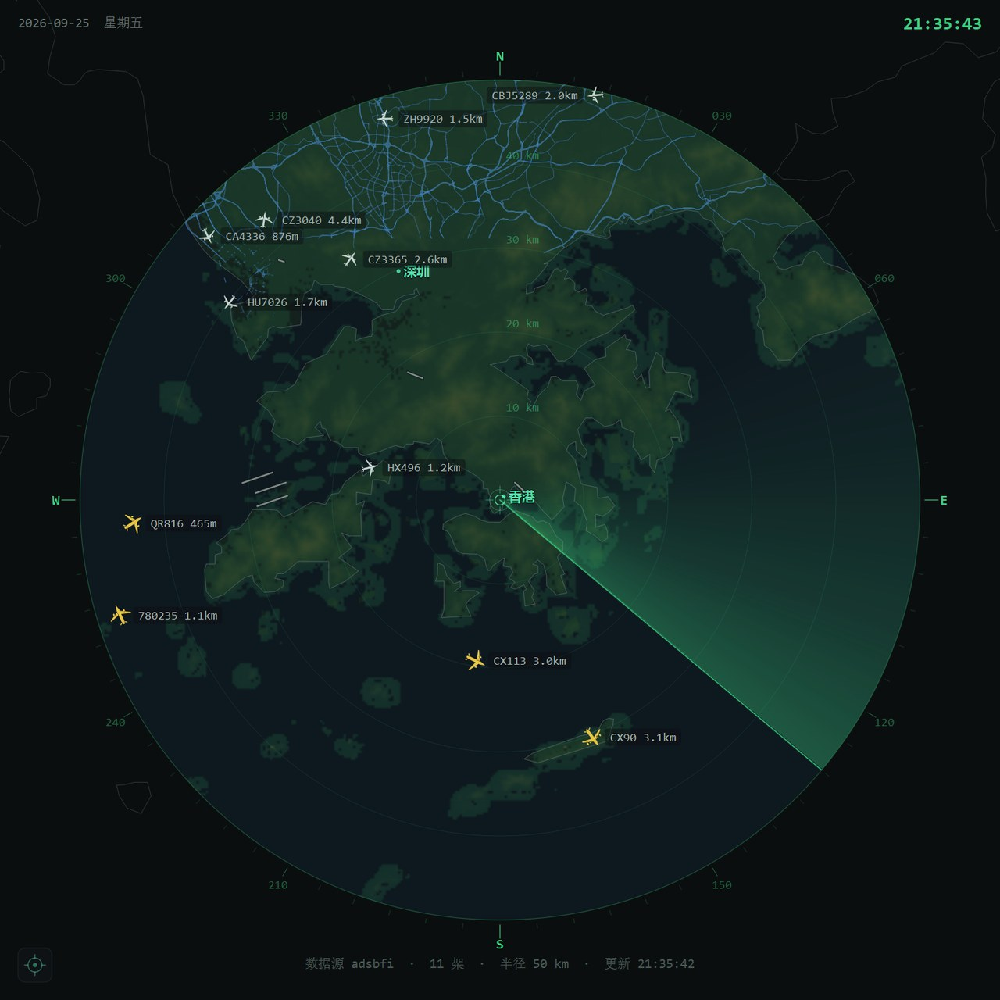
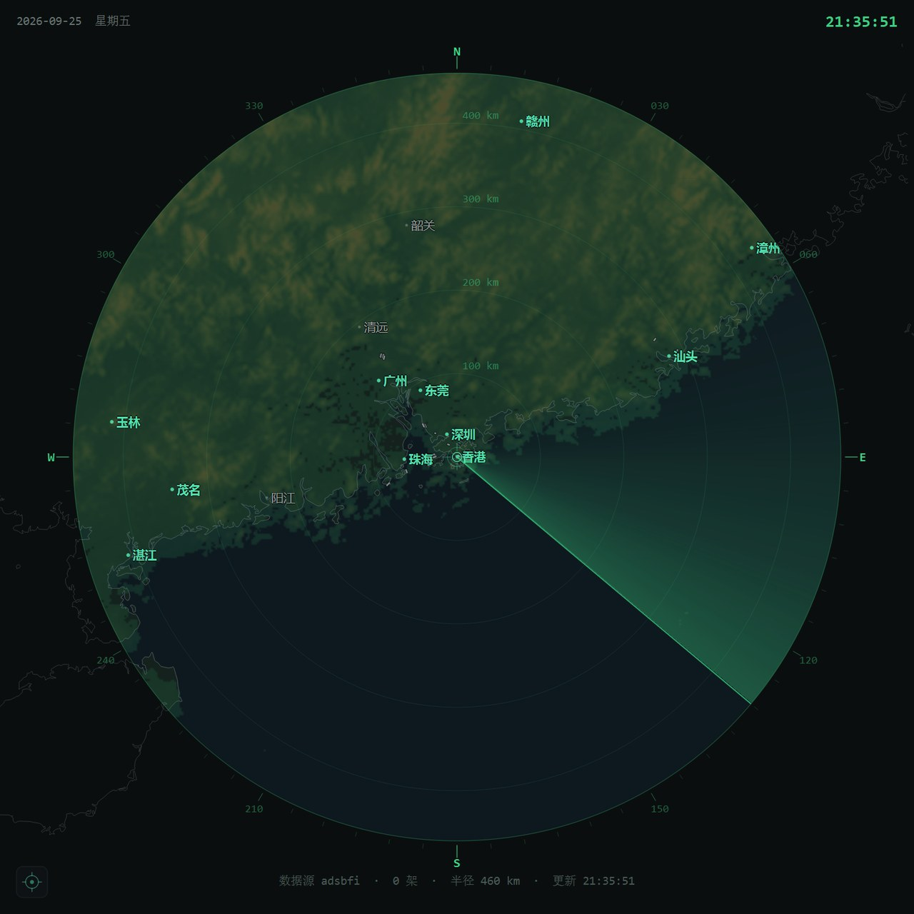
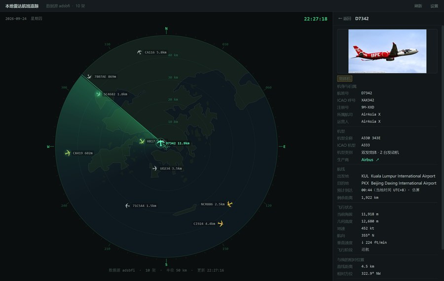
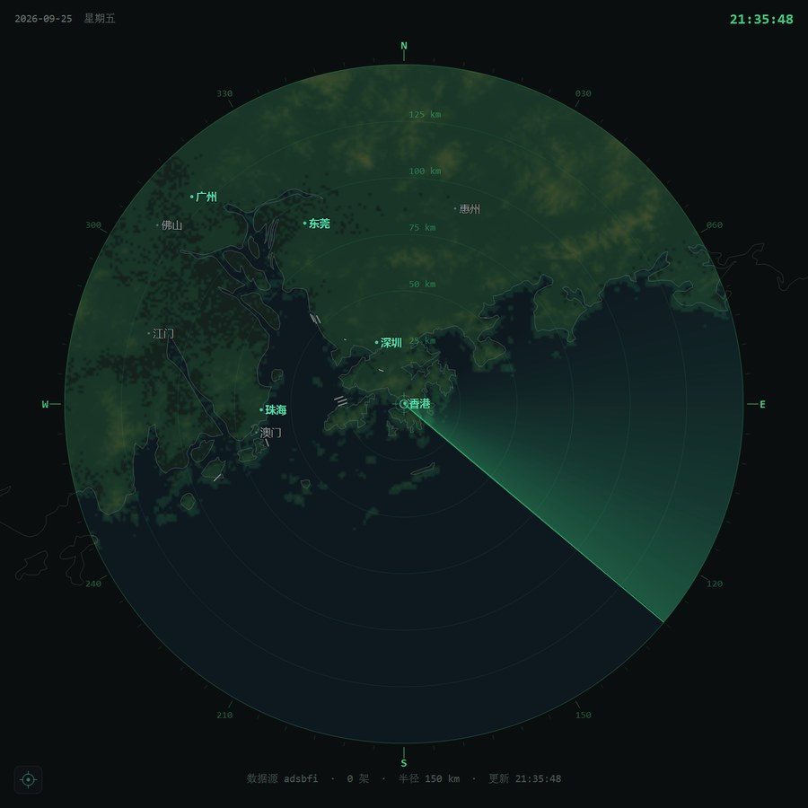
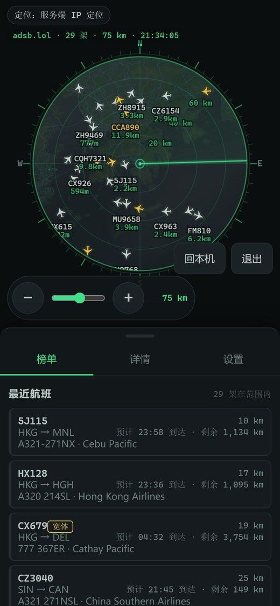
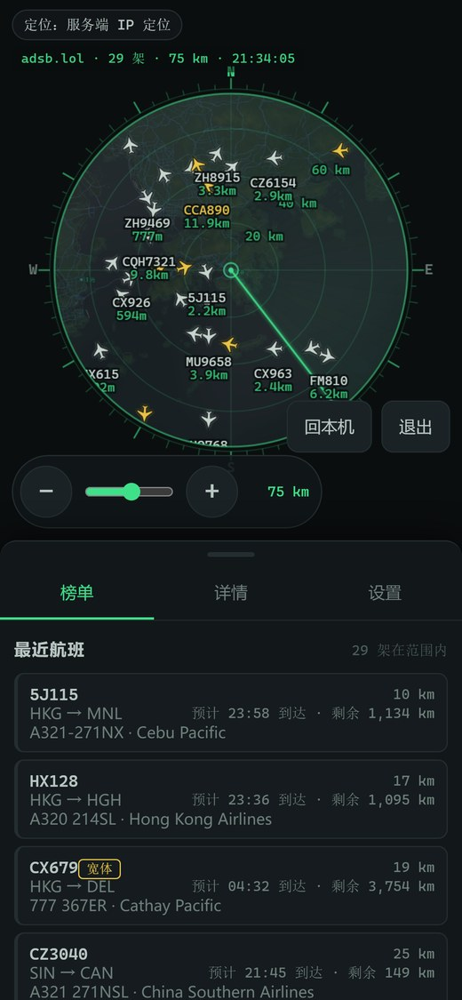
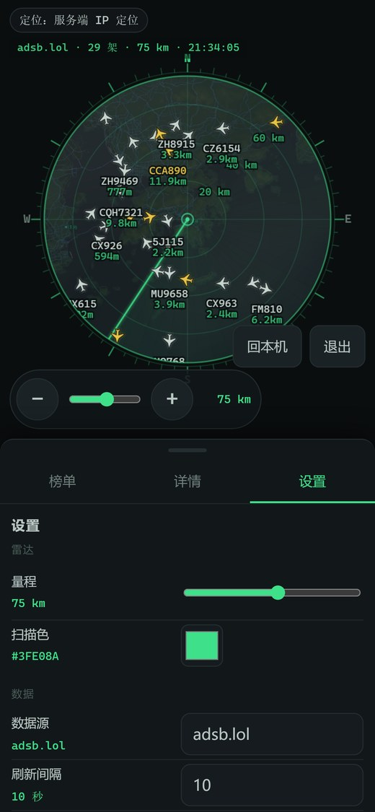
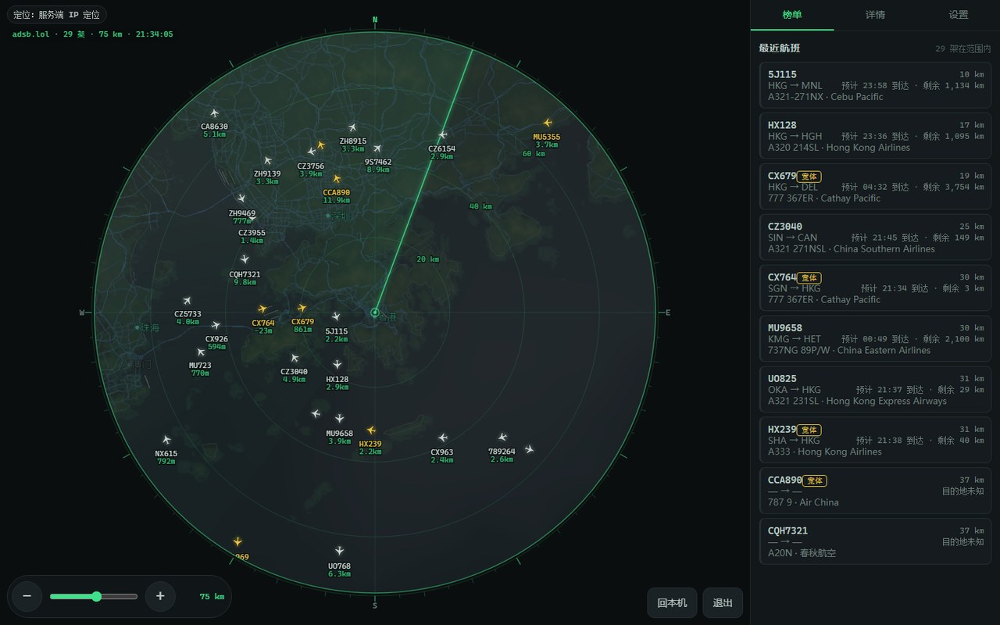
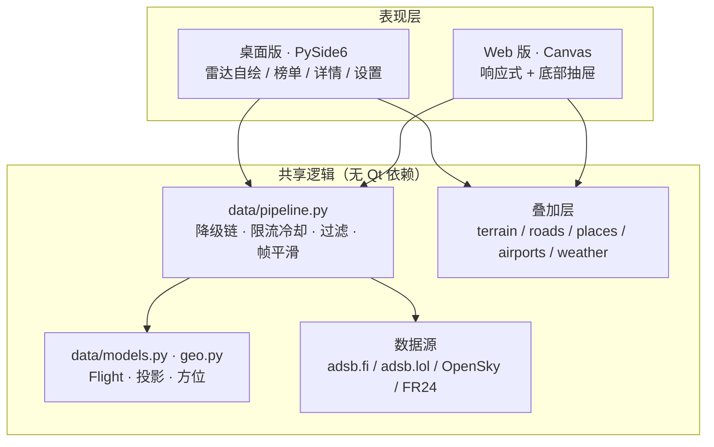

# 本地雷达航班追踪


> 一个**雷达风格的航班追踪器**：以你的位置为圆心，把附近的真实飞机画在圆形雷达盘上，
> 带量程环、罗盘刻度、扫描线和机型图标。提供**桌面版**（PySide6）与**手机可用的 Web 版**，
> 两者共用同一套数据与几何逻辑。



它不是地图上叠几个飞机图标——它刻意做成**真实的雷达观感**：北向上、极坐标投影、
按航向旋转的机型剪影、扫描线扫过时目标泛出的回波。数据来自公开的社区 ADS-B 网络，
不依赖任何商业 API key。

## 目录

- [为什么值得一看](#为什么值得一看)
- [界面预览](#界面预览)
- [快速开始（桌面版）](#快速开始桌面版)
- [Web 版（手机可用）](#web-版手机可用)
- [打包成 exe](#打包成-exe)
- [架构](#架构)
- [数据源](#数据源)
- [配置](#配置)
- [测试](#测试)
- [已知限制](#已知限制)
- [路线图](#路线图)

## 为什么值得一看

**极坐标投影严格对齐。** 雷达盘用的是方位等距投影，与
[`app/geo.py`](app/geo.py) 里的 `Projector` 是同一套公式。高程栅格不是简单贴图，
而是按 `quadToQuad` 分块四边形映射，保证海拔色块与海岸线在同一像素位置——早期版本
在 460 km 量程上有 13.66 px 偏差，重新推导映射后降到 1.59 px。

**六层可独立开关的叠加信息**，全部来自公开数据：

| 图层 | 内容 | 数据来源 |
|---|---|---|
| 海拔高程 | 低地绿 → 高地红的着色，海平面以下透明 | AWS Terrain Tiles（Terrarium） |
| 主要路网 | 高速 / 干线 / 主干三级蓝色路网 | OpenFreeMap 矢量瓦片（自写 MVT 解析器） |
| 云图 | 云量栅格，覆盖率 `(cover/100)^1.4 × 0.20` | Open-Meteo 网格采样 |
| 城市名 | 圆点 + 名称，按人口与量程分级，最多 26 个且避让重叠 | Natural Earth 1:10m |
| 机场跑道 | 按真实方位与长度绘制的跑道 | OurAirports |
| 天气 | 圆心风向箭头 + 顶部气象摘要 | Open-Meteo |

**数据源降级与限流冷却。** 免费 ADS-B 镜像有配额，实测 `adsb.lol` 约 60 秒窗口 3 次。
本项目做了完整的降级链：主源 429 时**不切换、不用空数据糊弄**，而是保留上一帧并进入
90 秒冷却，同时对其它源继续尝试；各源覆盖是互补的（香港 `adsb.fi` 11 架、
`adsb.lol` 21 架），所以「返回空列表」也会继续问下一个源。

**桌面版与 Web 版共享一条数据管线。** 编排逻辑（降级、冷却、过滤、帧间平滑）
被抽到 Qt-free 的 [`app/data/pipeline.py`](app/data/pipeline.py)，两边共用。
这既避免了逻辑漂移，也让 Web 版可以部署在**没有 PySide6 的 Linux 服务器**上。

## 界面预览

| 雷达总览 | 大范围（460 km） |
|---|---|
|  |  |

| 航班详情 | 底图细节（高程 + 路网 + 城市名 + 跑道） |
|---|---|
|  |  |

**Web 版**（同一套数据，手机浏览器打开即可）：

| 手机 · 雷达 | 手机 · 榜单 | 手机 · 设置 | 桌面 · 分栏 |
|---|---|---|---|
|  |  |  |  |

窄屏下雷达铺满视口、榜单/详情/设置收进可拖拽的底部抽屉；宽屏恢复雷达 75% / 面板 25% 的分栏。

## 快速开始（桌面版）

**环境**：Python 3.10+，Windows 或 Linux。Windows 上会额外用 `winsdk` 取系统级精确定位。

```bash
git clone https://github.com/<你的用户名>/local-radar-flight-tracker.git
cd local-radar-flight-tracker

python -m venv .venv
# Windows
.venv\Scripts\activate
# Linux / macOS
source .venv/bin/activate

pip install -r requirements.txt
python main.py
```

**首次运行会下载约 81 MB 数据**（陆地/海岸线、机场、城市名），之后走本地缓存。
下载目录随运行方式而定：

- 源码运行：项目目录下的 `assets/`
- 打包运行：`%LOCALAPPDATA%\LocalRadarFlightTracker\`

**操作**：滚轮缩放量程（16 档，2 → 460 km）、单击选中航班、点击 `机场` 跳转到指定机场、
`设置` 调整半径/刷新间隔/数据源/配色与图层开关。

## Web 版（手机可用）

服务端基于 `aiohttp`，**不依赖 PySide6**，可直接跑在 Linux 上。

```bash
pip install -r requirements-web.txt

export FRT_PASSWORD='一个足够强的口令'   # 首次不设会自动生成并打印一次
export FRT_PORT=8080
python -m webapp.server
```

然后浏览器打开 `http://<服务器地址>:8080/`。默认只监听 `127.0.0.1`，
公网部署请务必走反向代理终止 TLS —— 详见 **[docs/DEPLOY.md](docs/DEPLOY.md)**。

### 安全设计

公网可访问是既定前提，所以这些不是可选项：

- **口令**：`scrypt` + 每实例随机盐，只存哈希；比对走 `hmac.compare_digest`
- **会话**：`secrets` 生成的令牌 + 服务端内存表 + 过期时间；Cookie 带
  `HttpOnly` / `SameSite=Strict` /（HTTPS 下）`Secure`
- **CSRF**：所有写操作要求自定义头 `X-Requested-With`，跨站表单无法伪造
- **登录节流**：按 IP 指数退避，成功即清零
- **接口限流**：按 IP 滑窗（默认 240 次/分钟）
- **代理头信任**：**仅在** `FRT_TRUST_PROXY=1` 时采信 `X-Forwarded-For`，
  否则客户端可伪造 IP 绕过限流
- **密钥脱敏**：接口只回 `has_fr24_api_key`，绝不回明文
- **CSP**：`default-src 'self'`，前端零外链、零内联脚本

这些行为都有测试覆盖（见 [测试](#测试)），并用真实 HTTP 请求逐条验证过。
**但请注意**：Web 版只在 390×844 与 1440×900 的模拟视口下验证过，
尚未在真机手机上实测触屏手感。

## 打包成 exe

```bash
pip install pyinstaller
python build_exe.py --onedir      # 目录模式（推荐，启动快）
python build_exe.py               # 单文件模式
python build_exe.py --console     # 保留控制台，排查启动问题时用
```

产物在 `dist/本地雷达航班追踪/`，约 16 MB（不含运行时下载的 81 MB 数据）。

两个踩过的坑，已写进脚本：

- **必须 `--collect-all numpy`**。PyInstaller 6.10 自带的 numpy hook 跟不上 numpy 2.x
  的目录布局，会漏收 `numpy/_core/_exceptions`；症状是启动即弹
  `Unhandled exception in script` 对话框，而外部看只是"进程在、CPU 为 0"。
- **冻结环境禁止调用 pip**。`main.py` 的依赖自检在打包后会把
  `sys.executable`（就是 exe 自己）当成 pip 启动，导致无限自我复制。
  现在是双重防护：冻结时跳过自检 + 顶层递归哨兵环境变量 `LOCAL_RADAR_CHILD`。

## 架构



### 目录结构

```
app/
  data/
    pipeline.py    # 编排中枢：降级链、限流冷却、过滤、帧间平滑（无 Qt）
    manager.py     # 仅负责 QThread 调度，逻辑全部委托给 pipeline
    models.py      # Flight 数据模型 + 显示格式化
    sources.py     # 数据源注册表与降级链定义
    source_*.py    # 各数据源实现
    enrich.py      # 机型/注册号/实拍图富化（带磁盘缓存）
  geo.py           # 方位等距投影、大圆距离、方位角
  terrain.py       # 高程栅格取样与色标
  basemap.py       # 陆地/海岸线多边形裁剪与投影
  roads.py         # 手写 MVT 解析 + 路网取样
  places.py        # 城市名分级与避让
  airports.py      # 机场/跑道数据库
  weather.py       # 气象与云量场
  config.py        # 配置读写与校验
  ui/              # 桌面版界面（Qt）
webapp/
  server.py        # aiohttp 路由、中间件、静态资源
  auth.py          # scrypt 口令、会话、登录节流
  limits.py        # 滑窗限流、客户端 IP 口径
  frames.py        # 帧缓存 + 单飞（避免 N 个客户端放大成 N 倍上游请求）
  serialize.py     # Flight → JSON（格式化在服务端完成）
  render.py        # 服务端底图预渲染（Pillow，无 Qt）
  static/          # 原生 HTML/CSS/JS，无构建步骤
tests/             # 85 个单元测试 + 两个端到端脚本
docs/              # 设计、Web 契约、部署文档
```

**为什么格式化放在服务端？** `Flight` 上已有一套 `display_*` 方法（海拔短标签、航向方位、
飞行阶段、ETA 文案…）。Web 端只消费 `display` 子对象，不重新推导单位与格式，
两端的文案因此天然一致。

## 数据源

| 标识 | 上游 | 说明 |
|---|---|---|
| `adsbfi` | adsb.fi | 默认源，覆盖较广 |
| `adsblol` | adsb.lol | 部分地区更全；配额约 60 秒窗口 3 次 |
| `opensky` | OpenSky Network | 匿名额度 400 credits/天，仅按矩形查询，需本地剔除圆外目标 |
| `fr24` | Flightradar24 | **占位实现**，尚未接入 |

源之间是**互补**关系，不是简单备份：同一个位置不同源返回的架数可能差一倍。
主源返回空列表时会继续询问下一个源；只有所有源都答不上来才进入"数据延迟"状态。

## 配置

桌面版配置在 `config.json`（首次运行自动生成）。Web 版的运行参数单独放在
`webapp_config.json`（用户偏好仍复用 `config.json`）——把「界面偏好」和
「监听地址 + 口令哈希」分开，避免整份配置回给前端时把密钥带出去。

| 键 | 默认 | 范围 / 取值 |
|---|---|---|
| `source` | `adsbfi` | `adsbfi` / `adsblol` / `opensky` / `fr24` |
| `radius_km` | `50.0` | 1 – 460 |
| `refresh_sec` | `10` | 3 – 300 |
| `max_flights` | `60` | 5 – 200 |
| `stale_limit_sec` | `60` | 10 – 600（位置超过此秒数即丢弃） |
| `show_ground` | `false` | 是否显示地面目标 |
| `altitude_unit` | `m` | `m` / `ft` |
| `scan_color` | `#3FE08A` | 任意 `#RRGGBB` |
| `bg_level` | `0` | 0 – 2（背景提亮档位） |
| `show_terrain` 等六个 | `true` | 各叠加层开关 |
| `location.mode` | `auto` | `auto` / `manual` |

## 测试

```bash
python tests/test_geo.py               # 35 项：投影、距离、方位、量程环
python tests/test_pipeline.py          # 18 项：降级链、冷却、过滤、帧平滑
python tests/test_webapp_security.py   # 28 项：口令、会话、节流、限流、脱敏
python tests/test_no_qt_import.py      #  4 项：无 PySide6 环境下可导入
python tests/verify_webapp.py          # 端到端：Qt 惰性化 + 底图出图 + 前端语法
```

`verify_webapp.py` 会顺带把桌面版与 Web 版的底图各渲一张 PNG 到 `%TEMP%`，
供人眼核对投影与配色——**能出图不等于画对了**，这一步刻意保留人工确认。

Web 版另有一个 CDP 驱动的界面验证脚本思路：用 `--remote-debugging-port` 启动
headless Chrome，通过 DevTools 协议登录、截图、采样 canvas 像素，确认"确实画上了东西"。
静态检查和语法检查都验证不了这一点。

## 已知限制

坦白列出，避免误判：

1. **社区 ADS-B 在中国大陆覆盖稀疏。** 实测厦门、乌鲁木齐三源全部返回 0；
   香港/伦敦/纽约则正常（113 / 94 / 11–21 架）。这是接收站分布问题，不是程序缺陷。
2. **没有拖拽平移。** 圆心只能通过"跳转机场"或"回本机"改变，放大后想看别处做不到。
3. **`fr24` 数据源是空壳**，在设置里选了也不会有数据。
4. **OpenSky 匿名额度很小**（400 credits/天），频繁刷新很快耗尽，返回 0。
5. **Web 版未在真机手机上验证**，只做了模拟视口；双指缩放、刘海安全区等仍未实测。
6. **Web 版首次拉取约 14 秒**（上游请求 + 信息富化），期间榜单显示"加载中"。
7. 雷达盘较小时，部分航班标签会被避让机制省略，这是刻意的取舍。

## 路线图

- [ ] 多源结果合并（按 `icao24` 去重），而不是「第一个非空即返回」
- [ ] 鼠标/触摸拖拽平移
- [ ] 航迹线（保留最近 N 个位置点）
- [ ] 全局异常钩子 + 滚动日志（打包版崩溃时目前信息量为零）
- [ ] 呼号搜索、榜单筛选（只看宽体 / 只看爬升中）
- [ ] `fr24` 真实实现，或从 UI 撤掉
- [ ] Web 版：PWA 离线缓存、数据源切换
- [ ] 真机手机实测与触屏手感调优

## 贡献

欢迎 issue 与 PR。提交前请确保：

```bash
python tests/test_geo.py && python tests/test_pipeline.py && \
python tests/test_webapp_security.py && python tests/test_no_qt_import.py
```

全部通过。新增的编排/安全逻辑请补测试——这两块出错时的表现都很隐蔽
（前者是"航班莫名变少"，后者是"看起来能用但能被绕过"）。

## 许可

[MIT](LICENSE)

## 数据来源与致谢

本项目只做展示与聚合，所有航班数据版权归各自来源所有：

- [adsb.fi](https://adsb.fi) · [adsb.lol](https://adsb.lol) — 社区 ADS-B 镜像
- [OpenSky Network](https://opensky-network.org) — 学术非营利
- [Natural Earth](https://www.naturalearthdata.com) — 陆地、海岸线、城市名（公有领域）
- [OurAirports](https://ourairports.com) — 机场与跑道（公有领域）
- [Open-Meteo](https://open-meteo.com) — 气象与云量
- [OpenFreeMap](https://openfreemap.org) — 矢量瓦片底图
- [AWS Terrain Tiles](https://registry.opendata.aws/terrain-tiles/) — 高程数据

使用前请遵守各数据源的服务条款；请勿用于任何航空导航、飞行决策或安全用途。
本项目仅供观察与学习。
