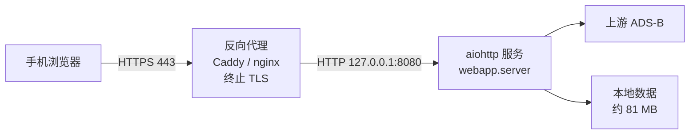

# Web 版部署

公网可访问是这个服务的既定前提，所以这份文档的重点是**别把口令和会话暴露在明文上**。
设计与安全取舍见 `docs/WEB.md`。

> 诚实声明：下面在 Linux 上的每一步我**没有实机验证过**（开发机是 Windows）。
> 已实测的只有本地启动与全部 HTTP 行为（29 项检查）。Linux 相关的部分来自标准做法，
> 首次部署时请按第 9 节的安全清单逐条确认。

## 1. 目标形态



关键点：**aiohttp 只监听回环地址**，TLS 由反代终止。
不要把它直接暴露到公网 —— 明文 HTTP 下口令和会话令牌会以明文过网。

## 2. 服务端环境

需要 Linux（或任何能跑 Python 3.11+ 的系统），**不需要** Windows，也不需要 PySide6。

```bash
sudo useradd -r -s /usr/sbin/nologin radar
sudo mkdir -p /opt/radar && sudo chown radar:radar /opt/radar

git clone <你的仓库> /opt/radar           # 或直接拷贝整个项目目录
cd /opt/radar
python3 -m venv .venv
.venv/bin/pip install -r requirements-web.txt
```

## 3. 首次数据准备（**已知缺口，必读**）

服务端首次运行需要约 81 MB 的底图 / 机场 / 地名数据。**目前没有一键下载入口** ——
`webapp/server.py` 只做加载、不做下载（这是有意为之：在请求路径上触发下载会阻塞事件循环，
而且会把 16 MB 的下载算到某个倒霉请求的头上）。

当前可用的两种准备方式：

1. **从已有机器拷贝**（推荐、最快）：把开发机上数据根目录里的 `assets/data/`、
   `assets/cache/`、`assets/icons/` 一并拷到服务器的项目目录下，权限给 `radar`。
2. **先在服务器上跑一次桌面版** `python main.py` 完成下载，再由 `webapp` 复用同一份数据。

> 待补：一个 `python -m webapp.fetch_data` 命令，把下载流程显式化。
> 在那之前，第 1 种方式是部署的首选路径。

数据根目录由 `app/config.py` 的 `_resolve_data_root()` 决定：未打包运行时就是**项目目录**，
所以拷到项目下即可。

## 4. 口令

**优先用环境变量，不要写进配置文件。** 进程环境只在内存里，而配置文件会被备份、
被同步、被误提交。

```bash
# 生成一个强口令
python3 -c "import secrets; print(secrets.token_urlsafe(18))"
```

若两者都没提供，服务首次启动会**自动生成一个随机口令并打印到控制台一次**，
哈希后存入 `webapp_config.json`。生产环境不要依赖这条路径——
容器/服务日志可能被留存。

## 5. 本地启动自检

先把服务跑起来、在服务器本机确认可用，再挂反代：

```bash
FRT_HOST=127.0.0.1 FRT_PORT=8080 FRT_PASSWORD='你生成的口令' \
  .venv/bin/python -m webapp.server
```

```bash
curl -s -o /dev/null -w '%{http_code}\n' http://127.0.0.1:8080/          # 200
curl -s -o /dev/null -w '%{http_code}\n' http://127.0.0.1:8080/api/state # 401（未登录，正确）
```

`401` 是**期望结果**，说明会话门禁在工作。

## 6. 反向代理与 TLS

### 方案 A：Caddy（推荐，自动申请并续期证书）

```
radar.example.com {
    reverse_proxy 127.0.0.1:8080
    encode zstd gzip
}
```

Caddy 会自动加上 `X-Forwarded-For` 与 `X-Forwarded-Proto`。

### 方案 B：nginx + certbot

```nginx
server {
    listen 443 ssl http2;
    server_name radar.example.com;

    ssl_certificate     /etc/letsencrypt/live/radar.example.com/fullchain.pem;
    ssl_certificate_key /etc/letsencrypt/live/radar.example.com/privkey.pem;

    location / {
        proxy_pass http://127.0.0.1:8080;
        proxy_set_header Host              $host;
        proxy_set_header X-Real-IP         $remote_addr;
        proxy_set_header X-Forwarded-For   $proxy_add_x_forwarded_for;
        proxy_set_header X-Forwarded-Proto $scheme;
    }
}

server {
    listen 80;
    server_name radar.example.com;
    return 301 https://$host$request_uri;
}
```

配置好后**必须**给服务开代理信任，否则会话 Cookie 不会带 `Secure`：

```bash
FRT_TRUST_PROXY=1
```

反过来同样重要：**反代之外不要设 `FRT_TRUST_PROXY=1`。** 一旦开启，服务就会采信
客户端自己发来的 `X-Forwarded-For`，攻击者只要每次请求换一个伪造 IP，
按 IP 的限流与登录锁定就同时失效。

## 7. systemd

`/etc/systemd/system/radar.service`：

```ini
[Unit]
Description=Local Radar Flight Tracker (web)
After=network-online.target
Wants=network-online.target

[Service]
Type=simple
User=radar
WorkingDirectory=/opt/radar
Environment=FRT_HOST=127.0.0.1
Environment=FRT_PORT=8080
Environment=FRT_TRUST_PROXY=1
# 不建议把口令写在这里（unit 文件通常全局可读）。
# 用 EnvironmentFile 指向一个 600 权限的文件：
EnvironmentFile=/etc/radar.env
ExecStart=/opt/radar/.venv/bin/python -m webapp.server
Restart=on-failure
RestartSec=5

# 收紧权限
NoNewPrivileges=true
PrivateTmp=true
ProtectSystem=strict
ProtectHome=true
ReadWritePaths=/opt/radar

[Install]
WantedBy=multi-user.target
```

```bash
sudo install -m 600 /dev/null /etc/radar.env
echo 'FRT_PASSWORD=你生成的口令' | sudo tee /etc/radar.env >/dev/null
sudo systemctl daemon-reload
sudo systemctl enable --now radar
sudo systemctl status radar
```

## 8. 内网穿透（不想买服务器时）

本机或小主机跑服务，用隧道暴露：

```bash
cloudflared tunnel --url http://127.0.0.1:8080
```

隧道同样是终止 TLS 的一层，所以**也要设 `FRT_TRUST_PROXY=1`**，并确认隧道确实转发了
`X-Forwarded-Proto`（Cloudflare 会）。

## 9. 部署后安全清单（逐条确认，别跳过）

| # | 检查 | 怎么确认 |
|---|---|---|
| 1 | 只有反代监听公网，aiohttp 在回环 | `ss -ltnp` 应看到 8080 绑在 `127.0.0.1` |
| 2 | `http://` 强制跳 `https://` | 浏览器访问 http 应被 301 |
| 3 | 会话 Cookie 带 `Secure` + `HttpOnly` + `SameSite=Strict` | 浏览器开发者工具 → Application → Cookies |
| 4 | 响应带 HSTS 与 CSP | 开发者工具 → Network → Response Headers |
| 5 | `FRT_TRUST_PROXY=1` 仅在反代之后 | 直接 `curl -H 'X-Forwarded-For: 1.2.3.4'` 打 8080，应不生效 |
| 6 | 未登录访问 `/api/*` 返回 401 | `curl -o /dev/null -w '%{http_code}' https://…/api/state` |
| 7 | 口令强度足够 | ≥ 16 字符随机串，不是可猜的词 |
| 8 | 限流生效 | 快速连发请求，应出现 429 |
| 9 | 登录失败会锁 | 连续错 5 次，应被锁定且等待时间递增 |
| 10 | `/api/state` 里没有密钥明文 | 只应有 `has_fr24_api_key`，不该有 `fr24_api_key` |
| 11 | 服务不以 root 运行 | `systemctl show radar -p User` |
| 12 | 日志不会泄露口令 | 检查 journalctl；首次自动生成的口令会打印，注意留存策略 |

## 10. 排错

**页面打不开，`/` 返回 503**
前端资源缺失 —— `webapp/static/index.html` 不存在，或工作目录不对。
服务端 `handle_index` 在文件缺失时给的就是 503（而不是 500），这是刻意区分的信号。

**`/api/flights` 一直返回空航班、`notice` 提示限流**
上游 ADS-B 的配额是按服务器的。看 `/api/state` 的 `cooling` 字段，里面有各源剩余冷却秒数。
如果所有源长期都在冷却，说明有客户端在绕过帧缓存直连 —— 检查是不是有人在直接轮询接口。

**登录后又被踢回登录页**
会话表存在**进程内存**里（刻意不用 JWT：无状态令牌无法在怀疑泄露时立刻失效）。
由此有两种成因：一是服务重启过（`Restart=on-failure`、部署新版本、机器重启），
内存里的令牌随之清空；二是**起了多个进程而请求被分派到不同进程** —— 令牌在 A 进程有效、
在 B 进程无效。本服务是单进程设计：只跑一个实例，反代不要对它做负载均衡。

**`/api/basemap` 一直 503**
`webapp/render.py` 不可用（缺 Pillow，或文件缺失）。
`/api/flights` 与雷达目标绘制不依赖它，应当能正常降级。

**机场搜索 503**
机场数据未就绪（见第 3 节），`AirportDatabase.load()` 返回 False。
