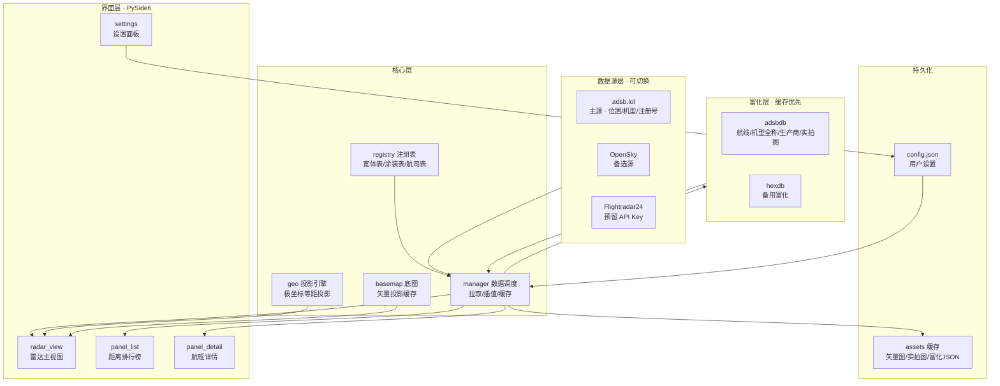

# 本地雷达式航班追踪软件 · 设计方案

> 阶段一交付物 · 项目根目录：`D:\AI\idea\flight`
> 本方案中的全部数据结论均来自**本机实测**（Python 3.11.9 / Windows），非文档推测。

---

## 0. 摘要

以用户真实经纬度为圆心，在可调半径的圆形雷达视图内实时追踪周边航班。PySide6 自绘雷达盘 + 矢量海岸线底图 + 极坐标等距投影保证地理关系严格正确；数据层采用**主源 + 富化源**架构，实测可稳定获取航司、机型全称、生产商、出发/目的地、注册实拍图等完整字段。

---

## 1. 技术可行性实测报告

### 1.1 数据源选型（已实测，含限流压力测试）

以用户真实位置（香港九龙 `22.3031, 114.1788`）为圆心、50 km 为半径：

| 数据源 | 香港航班数 | 10 秒刷新能否持续 | 注册号/机型 | 宽体分类 | 航司/航线 | 备注 |
|---|---|---|---|---|---|---|
| **adsb.fi** | **26–37 架** | ✅ **30/30 连续成功**（5 分钟，约 214 ms） | ✅ | ✅ `category` | ⚠️ 需富化 | **选为默认主源** |
| adsb.lol | 34–48 架 | ❌ 配额仅 **3 次/分钟** | ✅ | ✅ | ⚠️ 需富化 | 数据略多，降为备选 |
| OpenSky `states/all` | 26 架 | ✅ 宽松 | ❌ | ❌ | ❌ | 字段贫瘠，仅兜底 |
| airplanes.live / adsb.one | — | — | — | — | — | 403 拒绝 |
| Flightradar24 | — | — | — | — | — | 无免费公开 API |

**关键发现一：限流不能用"1 request/second"来估算。**
adsb.lol 实测为**滑动窗口配额**——间隔 1 秒连发，前 3 次成功、第 4 次即 HTTP 429；
间隔 25 秒才可持续（8/8 成功）。按 10 秒刷新（6 次/分钟）使用必然被拒。

**关键发现二：adsb.fi 可与 adsb.lol 共用一套解析逻辑。**
两者都基于 tar1090，字段完全一致，差异仅在 URL 路径
（adsb.fi 用 `/lat/{lat}/lon/{lon}/dist/{r}`，adsb.lol 用 `/point/{lat}/{lon}/{r}`）
与响应列表键名（`aircraft` vs `ac`）。因此合并为一个适配器模块共用解析逻辑。

**最终架构**：`adsb.fi` 默认主源 → `adsb.lol` 备选 → `OpenSky` 兜底。
遇到 429 时**不降级**，而是保留上一帧数据等下一轮重试。

**关键发现三：两个 tar1090 镜像的 `radius` 参数单位都是海里，上限 250 nm ≈ 463 km**
（实测 radius=500 直接返回 HTTP 400）。因此雷达半径上限设为 460 km，
避免雷达圈超出实际数据覆盖范围。响应中的 `dst` 同样是海里、`dir` 为度——
本软件一律用本地 haversine 重算距离与方位，不采信这两个字段。

### 1.2 富化源实测（adsbdb / hexdb）

单次调用即可拿到详情页全部字段，实测样本：

```
GET https://api.adsbdb.com/v0/aircraft/781001
→ 机型全称 "787 9" | ICAO机型 B789 | 生产商 Boeing
   注册号 B-7835 | 运营人 Hainan Airlines
   实拍图 https://image.airport-data.com/aircraft/001411389.jpg   (实测可下载 84.6 KB)

GET https://api.adsbdb.com/v0/callsign/CHH7713
→ 航司 Hainan Airlines (HU/CHH) | IATA 航班号 HU7713
   出发地 PEK 北京首都国际机场 (40.0801, 116.5850)
   目的地 SZX 深圳宝安国际机场 (22.6393, 113.8110)
```

若 adsbdb 不可用，`hexdb.io` 提供同维度备用字段（Manufacturer / ICAOTypeCode / Type / RegisteredOwners / OperatorFlagCode）。

### 1.3 其余关键验证

| 验证项 | 结果 |
|---|---|
| Windows 高精度定位 | ✅ `winsdk` 实测返回 `22.3031505, 114.178833`，精度 **86 m**（与两条 IP 定位源交叉一致） |
| 定位服务 `lfsvc` | ✅ 运行中 |
| PySide6 | ✅ 6.11.2，QtSvg / QtNetwork / QtWidgets 均可用 |
| Natural Earth 矢量底图 | ✅ `ne_50m_land` 1.64 MB + `ne_50m_coastline` 1.64 MB，可本地缓存离线使用 |
| adsb.lol 限速 | ✅ 连续 4 次请求均约 840 ms 返回，无 429 |
| Planespotters 图片 API | ❌ 403，改用 adsbdb 返回的 `url_photo` |

### 1.4 实测发现的数据陷阱（已在设计中处理）

1. **`category` 字段不可靠**：实测 `CPA459 / B773 / category=A0`，B773 是典型宽体机却标为 A0。→ **宽体判定必须以机型 ICAO 代码表为准**，`category` 仅作辅助。
2. **地面航班会淹没雷达盘**：实测 60 架中大量 `alt_baro = "ground"`（停机坪/滑行，如 `CPA198`、`CPA521`）。→ 需**地面航班开关**，默认隐藏。
3. **数据新鲜度差异大**：`seen` 从 0.1 s 到 10.8 s 不等。→ 用 `seen_pos` 做陈旧度衰减，> 60 s 的航班不绘制。
4. **公开免费源无航班时刻表**。→ "预计起降时间"改为**可计算的 ETA 估算**（见 §6.5）。

---

## 2. 偏差项决策（已确认 ✅）

| # | 需求原文 | 实测问题 | 最终决策 |
|---|---|---|---|
| D1 | 默认使用 OpenSky 免费 API | 实测仅 3 架（北京）且无机型/航司/航线，功能无法成立 | ✅ **默认 adsb.fi**（唯一支持 10 秒刷新的免费源），adsb.lol / OpenSky / Flightradar24 均为设置面板可切换源 |
| D2 | OSM 在线瓦片 / 矢量海岸线 | OSM 瓦片风格无法做"深墨绿陆地 + 藏蓝海洋"，且需拼接、有网络延迟 | ✅ **矢量海岸线**（Natural Earth，3.2 MB 本地缓存），风格 100% 可控、离线可用、与航班同投影严格对齐 |
| D3 | 预计起降时间 | 无免费时刻表 API | ✅ 改为**基于地速与剩余大圆距离的 ETA 估算** + 出发/目的地**当地时间**显示 |
| D4 | 特殊涂装 | 无任何公开 API | ✅ 内置**可维护的本地 JSON 特殊涂装注册号表**（默认空表，不预填未经核实的数据）+ 客观特殊机型自动识别 |
| D5 | 雷达半径自定义 | 免费源单次查询上限 250 海里 ≈ 463 km，设更大只会让雷达圈超出数据范围 | ✅ 半径上限 460 km |

---

## 3. 系统架构



---

## 4. 文件结构清单

```
D:\AI\idea\flight\
├── main.py                       # 主入口：依赖自检 → 定位 → 启动窗口
├── requirements.txt              # 依赖清单
├── README.md                     # 运行说明 / 配置说明 / 常见问题
├── config.json                   # 运行时生成，用户设置持久化
├── docs\
│   └── DESIGN.md                 # 本设计方案
├── app\
│   ├── __init__.py
│   ├── config.py                 # 配置读写、默认值、范围校验
│   ├── theme.py                  # 军用暗色主题令牌：配色 / QSS / 三档字号
│   ├── geo.py                    # 极坐标等距投影、大圆距离、方位角、视口裁剪
│   ├── basemap.py                # Natural Earth 矢量加载 + 投影路径缓存
│   ├── locate.py                 # Windows Geolocator → IP 定位 → 手动校准
│   ├── data\
│   │   ├── __init__.py
│   │   ├── base.py               # 数据源接口 + 错误类型（含限流专用异常）
│   │   ├── models.py             # Flight / Route / AircraftInfo 数据模型
│   │   ├── source_tar1090.py     # tar1090 系镜像：adsb.fi（主源）/ adsb.lol（备选）
│   │   ├── source_opensky.py     # OpenSky 兜底源
│   │   ├── source_fr24.py        # Flightradar24 预留适配器
│   │   ├── sources.py            # 数据源工厂与降级链
│   │   ├── enrich.py             # adsbdb / hexdb 富化 + 磁盘缓存 + 限速
│   │   ├── registry.py           # 宽体机型表 / 特殊涂装表 / 航司表 / 时区估算
│   │   └── manager.py            # QThread 调度、平滑插值、信号广播
│   └── ui\
│       ├── __init__.py
│       ├── main_window.py        # 主窗口 75/25 分栏 + 角标时钟
│       ├── radar_view.py         # 雷达盘：刻度圈 / 扫描线 / 航班 / 交互
│       ├── panel_list.py         # 距离排行榜（前 10）
│       ├── panel_detail.py       # 航班详情页
│       ├── settings_dialog.py    # 设置面板
│       └── widgets.py            # 通用控件：标签 / 分隔线 / 返回按钮
├── assets\
│   ├── data\                     # 首次运行自动下载并缓存
│   │   ├── ne_50m_land.geojson
│   │   └── ne_50m_coastline.geojson
│   ├── photos\                   # 飞机实拍图本地缓存
│   └── icons\                    # 矢量飞机图标等
└── tests\
    ├── test_geo.py               # 投影 / 距离 / 方位角精度校验
    └── test_sources.py           # 数据源解析与降级容错
```

---

## 5. 依赖清单

**核心（必须）**

| 包 | 版本要求 | 本机状态 | 用途 |
|---|---|---|---|
| PySide6 | ≥ 6.6 | ✅ 6.11.2 已装 | GUI 框架、自绘雷达盘、动画 |
| requests | ≥ 2.31 | ✅ 2.32.5 已装 | HTTP：航班数据、富化信息与矢量底图下载 |
| numpy | ≥ 1.26 | ✅ 2.3.5 已装 | 底图海岸线的向量化视口筛选 |
| shapely | ≥ 2.0 | ✅ 2.1.2 已装 | 陆地多边形裁剪——填充必须保持多边形闭合 |
| winsdk | ≥ 1.0.0b10 | ✅ 已装 | Windows 系统高精度定位 API |

`main.py` 启动时自动检查上述包，缺失则询问并调用 pip 安装。

---

## 6. 核心算法与实现要点

### 6.1 极坐标等距投影（地理正确性的关键）

**不使用**经纬度线性映射（在高纬度会造成距离与方位双重失真）。采用以圆心为中心的**方位等距投影（Azimuthal Equidistant）**，实现极简且严格正确：

```
d      = haversine(圆心, 目标点)          # 大圆距离 (km)
θ      = initial_bearing(圆心, 目标点)    # 初始方位角 (0° = 正北, 顺时针)
r_px   = 雷达半径像素

sx = cx + (d / R_km) * r_px * sin(θ)    # 东向
sy = cy - (d / R_km) * r_px * cos(θ)    # 北向（屏幕 y 轴向下，故取负）
```

**该式的物理含义**：屏幕上任意点到圆心的像素距离与真实大圆距离成正比，像素方位角与真实方位角完全相等。因此"距离刻度圈"与"方位刻度"是严格成立的，而非视觉近似。

底图海岸线多边形走**同一变换**，保证海岸线与航班图标的位置严格一致。

### 6.2 扫描动效与雷达回波

- `QConicalGradient` 绘制 60° 余晖拖尾，亮边位于扫描前沿，6 s/圈匀速（`QTimer` 33 ms 步进，角度 = `t/6000*360`）。
- 回波高亮：为每个航班记录 `last_swept_at`，扫描线角度经过该航班方位角时刷新时间戳，之后 1.5 s 内按指数衰减叠加强光晕。

### 6.3 位置平滑过渡

数据每 10 s 刷新，但绘制 30 fps：
- 收到新数据 → 记录 `prev_pos` 与 `target_pos`，按 `t/T` 缓动插值；
- 同时按地速与航向做**航位推算**（dead reckoning）外推，使图标匀速前进而非每 10 s 跳一次；
- 实测 `seen_pos` 用于陈旧度衰减，> 60 s 不绘制。

### 6.4 富化请求策略（避免被封）

- 仅对**新出现的** `hex` / `callsign` 发请求，已缓存的直接命中；
- 磁盘缓存 `assets/cache/enrich.json`，TTL：机型/注册号 7 天，航线 1 天；
- 并发上限 4，单域请求间隔 ≥ 200 ms，失败指数退避并落 hexdb 备用。

### 6.5 ETA 估算（替代"预计起降时间"）

```
剩余距离 = haversine(当前位置, 目的地机场坐标)
剩余时间 = 剩余距离 / 当前地速
预计到达 = UTC 当前时间 + 剩余时间  →  换算为目的地机场当地时间
```
地速为 0 或地面状态时不显示 ETA。

### 6.6 底图精度与渲染性能

**数据精度取 1:10m 而非 1:50m。** 1:50m 在 50 km 视口下会把香港一带的岛屿
压成几边形，肉眼即可看出"多边形块"的痕迹。实测两者规模对比：

| 数据 | 文件大小 | 陆地环数 | 陆地坐标点 |
|---|---|---|---|
| 1:50m | 1.6 MB | 1,422 | 60,669 |
| **1:10m** | **9.7 MB** | **6,838** | **446,175** |

精度提升 7.4 倍，代价是解析变慢（JSON 解析约 1 秒）与内存占用上升，
两者都由 pickle 缓存与后台加载消化。

**性能的关键在于两个图层用不同策略。** 1:10m 的陆地只有 11 个 feature，
最大的一块（欧亚大陆）就有 **27 万点**；若每次视口变化都完整投影，实测需要
**165 ms**，滚轮缩放会明显卡顿。海岸线则有四十多万点。因此：

| 图层 | 策略 | 耗时 |
|---|---|---|
| 陆地填充 | shapely 多边形裁剪 `intersection(box)`，保留闭合性与内环 | 15–33 ms |
| 海岸线描边 | numpy 布尔运算筛出可见点 + 只投影连续段（两端各多取一个点伸到视口外） | 3–11 ms |

**为什么陆地不能用段提取。** 这是开发中踩到的一个陷阱：起初为了性能，
陆地也用了"只投影视口内可见段再 ``closeSubpath``"。描边看不出问题，
但填充会塌陷——多边形被截断后不再代表原来的区域，闭合出来的形状完全不同，
珠江口以西的大片陆地会漏成海洋色。**填充必须保持多边形完整**，
所以改用 shapely 裁剪。

**一个容易漏掉的情形**：视口完全落在某块陆地**内部**（例如在北京看 50 km 范围）
时，`intersection` 返回的是视口矩形本身（正好覆盖整个盘），填充自然正确；
若相交为空则说明视口在海洋或陆地的"洞"里，此时用 `contains` 判定
才决定要不要整盘填成陆地色。

其余不变：投影结果按 `(圆心, 半径, 像素半径)` 缓存为 `QPainterPath`；
雷达盘静态部分（底图 + 刻度圈 + 方位刻度）缓存为 `QPixmap`，每帧只重绘扫描线与航班。

---

## 7. 视觉规格（军用雷达主题）

### 配色令牌

| 用途 | 色值 | 说明 |
|---|---|---|
| 窗口背景 | `#0B0E0F` | 深炭黑，低对比不刺眼 |
| 面板背景 | `#12171A` | 右侧信息面板 |
| 分隔线 | `#1F2729` | 细分隔 |
| 雷达盘底 | `#0D1512` | 微绿渗色的暗底 |
| 扫描线 | `#3FE08A` | 亮绿，余晖径向渐隐 |
| 同心圈刻度 | `rgba(63,224,138,0.10)` | 极淡 |
| 陆地填充 | `#16241C` | 深墨绿 |
| 海洋填充 | `#0F1B2A` | 藏蓝 |
| 海岸线 | `#6C7B7F` | 浅灰白细线 |
| 航班图标（常规） | `#C8D6D0` | 灰白 |
| 航班图标（宽体） | `#E8C547` | 黄 |
| 主文字 | `#B9C7C2` | |
| 次文字 | `#6E7F7A` | |
| 高亮态 | `#5AFFC2` | 选中航班 / 悬停 |

### 排版与尺寸

- 数字与标号：`Consolas`（等宽，走秒不跳动）；中文：`Microsoft YaHei UI`
- 三档字号：小 `11/12`、中 `13/14`、大 `15/17`（次要/主要）
- 布局：左侧雷达区 75% / 右侧面板 25%，最小窗口 `1280 × 800`
- 雷达盘直径取 `min(区宽, 区高) - 80px`，四周留白给角标与方位刻度
- 左上角标：`2026-02-14 星期六`；右上角标：`14:23:07`（等宽字体，每秒刷新）

---

## 8. 数据与更新逻辑

**启动序列**：依赖自检 → 加载配置 → Windows 定位（失败降级 IP，再失败用手动校准值或默认坐标）→ 加载矢量底图（本地缓存命中则不联网）→ 首帧数据拉取 → 进入刷新循环。

**刷新循环**（默认 10 s，可设置）：拉取半径内航班 → 富化新 `hex`/`callsign` → 过滤（地面航班按开关、陈旧数据）→ 计算距离/方位 → 广播更新信号 → 排行榜重排（`QVBoxLayout` 淡入位移动画）→ 雷达平滑插值重绘。

**半径自适应**：滚轮缩放改变半径 → 重新拉取该半径数据 → 底图重新投影（走缓存）→ 刻度圈标签同步重算。

---

## 9. 交互规格

| 交互 | 行为 |
|---|---|
| 点击雷达图飞机图标 | 右侧切详情页，该机高亮 + 十字指示线 |
| 点击排行榜条目 | 同上 |
| 详情页「←」 | 返回排行榜 |
| 点击「生产商」文字 | `QDesktopServices.openUrl` 打开厂商官网 |
| 滚轮缩放 | 调整雷达半径（按档位步进，同步刷新数据） |
| 悬停飞机图标 | 浮起一行速览气泡（航班号 / 高度 / 距离） |

---

## 10. 交付状态

| 序 | 模块 | 状态 | 自检结果 |
|---|---|---|---|
| ① | `config.py` + `theme.py` + `geo.py` | ✅ | `tests/test_geo.py` 35 项断言全部通过 |
| ② | `data/` 数据层全套 | ✅ | 三源真实拉取、富化、降级链、后台调度全部验证 |
| ③ | `basemap.py` | ✅ | 下载 3.2 MB、pickle 缓存快 3.9 倍、圆形裁剪无溢出 |
| ④ | `radar_view.py` | ✅ | 8 方位映射偏差 **0.0000°**、距离等比精确、拖尾方向验证通过 |
| ⑤ | `panel_list.py` + `panel_detail.py` | ✅ | 行复用、重排动画、异步实拍图、边界数据容错 |
| ⑥ | `settings_dialog.py` + `main_window.py` | ✅ | 全参数生效与持久化、Windows 定位精度 85 m |
| ⑦ | 联调 + `README.md` | ✅ | 端到端冒烟测试通过 |

---

## 11. 降级与容错策略

| 故障 | 降级行为 |
|---|---|
| Windows 定位被拒/超时 | 降级 IP 定位（多源轮询）→ 再失败用配置中的手动坐标 |
| adsb.lol 不可用 | 自动切换 OpenSky（字段缺失部分显示 `—`） |
| adsbdb 富化失败 | 回落 hexdb → 再失败则仅显示原始字段，不阻塞主流程 |
| 矢量底图下载失败 | 雷达盘仅显示刻度与航班（地理关系仍严格正确） |
| 实拍图加载失败 | 显示机型剪影占位图 |
| 网络完全断开 | 雷达保留最后一帧数据并显示离线标识，后台静默重连 |

---

## 12. 开发实录：实测踩到的坑

以下问题都是**实测发现**的，不是推测。记录下来以备后续维护。

### 12.1 数据源

| # | 现象 | 结论 |
|---|---|---|
| 1 | 间隔 1 秒连发请求，前 3 次成功、第 4 次 HTTP 429 | adsb.lol 是**滑动窗口配额**（约 3 次/分钟），不是文档说的 1 req/s。按 10 秒刷新必然被拒 |
| 2 | `radius=500` 返回 HTTP 400 | 两个 tar1090 镜像的 radius 单位是**海里**且上限 250 nm ≈ 463 km |
| 3 | `dst` 与自算公里数的比值恒为 0.5388 | `dst` 单位是海里（1/1.852 = 0.5399）。**距离一律本地重算**，不采信该字段 |
| 4 | 同为 tar1090，adsb.fi 的路径是 `/lat/../lon/../dist/..`，响应键是 `aircraft`；adsb.lol 是 `/point/..`，键是 `ac` | 两者共用一份解析逻辑，只在 URL 模板与列表键名上区分 |
| 5 | `B773` 被标为 `category=A0` | `category` 字段不可靠，**宽体判定以 ICAO 机型码为准** |
| 6 | `baro_rate=0` 被 `or` 短路成 `geom_rate` | 0 是"平飞"这一**有效值**，必须显式判 `None` |

### 12.2 Qt / PySide6

| # | 现象 | 结论 |
|---|---|---|
| 7 | 用 `QGuiApplication` 创建 `QWidget` 直接进程崩溃（0xC0000409） | QWidget 属于 QtWidgets，**必须用 `QApplication`** |
| 8 | 设置 `app.setStyleSheet` 后自定义面板仍是系统浅灰底 | 直接继承 `QWidget` 的子类必须设 `WA_StyledBackground`，否则 Qt 不绘制 QSS 的 `background` |
| 9 | `setWidgetResizable(False)` 时列表行完全不可见 | 此时 viewport 不跟随滚动区尺寸，必须**手动 `setFixedWidth/Height`** |
| 10 | `view.grab()` 后再读扫描角，发现已被推进 60° | `grab()` 会跑一次事件循环，**QTimer 会触发**。测试时须先 `timer.stop()` |
| 11 | 像素采样结果与实际渲染不符 | `grab()` 返回的是**设备像素**位图，而圆心/半径是逻辑坐标，必须按 `devicePixelRatio` 换算 |

### 12.3 绘制

| # | 现象 | 结论 |
|---|---|---|
| 12 | 雷达盘外的界面四角出现陆地色块 | 底图多边形范围远超盘，必须 `setClipPath` 裁剪到圆内 |
| 13 | 缩小时贴边航班的标签飘到盘外几十像素 | 夹紧边界必须按**圆**算（`sqrt(r² - dy²)`），用 `center_x ± radius_px` 的矩形边框在盘上下方会显著偏大 |
| 14 | 半径缩小时盘外出现漂浮的飞机图标 | 数据层下一轮才返回新半径结果，绘制前必须按当前半径过滤 |
| 15 | 1:10m 数据下投影若逐点进行会明显卡顿 | 改用 numpy 布尔运算筛出可见点，再只投影连续可见段；海岸线用此法 |
| 16 | 视口完全在陆地内部时（如北京）陆地为空 | `intersection` 会返回视口矩形本身，填充自然正确；相交为空时才用 `contains` 判定 |
| 17 | **陆地填充在视口边缘整片塌陷成海洋色** | 陆地曾沿用海岸线的"只投影可见段再闭合"做法——多边形一被截断就不再代表原来的区域，珠江口以西的陆地整片漏填。**填充必须保持多边形闭合**，改用 shapely 裁剪 |
| 18 | 首版飞机图标像甲虫 | 机身半宽给到 0.17、尾部还向外扩张 1.6 倍、尾翼偏大。改为细长机身（半宽为半长的 6%~14%）+ 大后掠机翼（约 33°）+ 小尾翼，渲染 5 组候选逐一目视比对后定稿 |

### 12.4 机型分类

| # | 现象 | 结论 |
|---|---|---|
| 19 | `C172` 被判成"四发军用运输" | 短前缀 `C17` 抢先命中。**前缀表必须按长度降序**——最终改为由代码 `sorted` 自动排序，不靠人工维护 |
| 20 | `A310`（宽体）与 `A319`（窄体）同以 `A31` 开头 | 同上，`A310` 必须排在 `A31` 之前 |
| 21 | `ATR 72-600` 这类描述性文本无法前缀匹配 | 增加子串关键词表兜底（`ATR` / `CESSNA` 等厂牌名） |
| 22 | 数据源的机型码常带后缀（`A321-251NX`、`737NG 8HX/W`） | 判定必须用**前缀**而非精确匹配 |
| 23 | 首版飞机图标像飞蛾 | **机翼位置是最关键的参数**：原先放在距机头 19% 处，真实客机是 32%。改为按 A320 的真实俯视比例换算后才像飞机 |

### 12.5 新增图层（地形 / 路网 / 云图 / 机场 / 城市名）

| # | 现象 | 结论 |
|---|---|---|
| 24 | 雷达盘外出现大片半透明色块 | 地形与云图用 `drawImage` 画的是**矩形**（范围是整个数据栅格，比盘大得多），必须为覆盖层补上 `setClipPath` 圆形裁剪——底图有裁剪，新图层漏了 |
| 25 | 盘内出现两个巨大的灰色圆头线段 | **单位换算错误**：跑道宽度写成 `width_ft * 0.3048 * px_per_km`，把「米」当「公里」用，宽度放大 1000 倍（0.57 px → 573 px）。正确是 `width_ft * 0.3048 / 1000 * px_per_km` |
| 26 | 50 km 视野下路网拉回 11575 条折线 | 一个瓦片覆盖的范围远大于雷达视野，必须按视口包围盒裁剪；并设上限 4000 条 |
| 27 | `choose_zoom` 在大视野返回了最低层级而非"不适用" | 返回 `MIN_ZOOM - 1` 以表示"这种视野不该显示路网" |
| 28 | 50 km 视野取不到路网（zoom=9 被 MIN_ZOOM=10 挡掉） | 层级下限放宽到 8：50 km 视野要控制在 4 个瓦片内只能用 z9 |
| 29 | 云图网格 16×16 时大半径请求超时 | URL 过长（512 个坐标参数），实测 14×14（196 个）稳定，响应 1–2 秒 |
| 30 | 机场列表缺上海 / 广州 / 成都 | OurAirports 的 `municipality` 带括号后缀（`Shanghai (Pudong)`、`Guangzhou (Huadu)`），必须先剥离括号才能匹配中文对照表 |
| 31 | 机场列表缺香港 | 香港的 `iso_country` 是 `HK` 而非 `CN`（数据正确）。跳转列表改用 `CN/HK/MO/TW` 四地区 |
| 32 | Overpass API 三个公开镜像全部不可用 | 分别为超时、504、证书错误。路网改用 OpenFreeMap 的矢量瓦片，并手写精简 MVT（protobuf）解析器 |

### 12.6 覆盖层数据加载

地形、路网、云图都要联网（单次合计 1–3 秒），全部放在后台线程；
缩放时用 400 ms 防抖，避免连续滚轮触发一串请求。
城市与机场是本地查询，跟着一起做。天气单独加载——它只与用户位置有关，
不随视口变化，15 分钟刷新一次。

### 12.7 性能与交互（用户反馈驱动）

| # | 现象 | 结论 |
|---|---|---|
| 33 | 点「机场」按钮毫无反应 | `airport_picker.py` 用了 `QHBoxLayout` **却忘了 import**，抛 `NameError`；Qt 会吞掉事件处理器里的异常，界面上只表现为"点了没反应"。修复后加了 try/except 把失败原因显示到状态栏，避免这类问题再次静默 |
| 34 | 滚轮缩放很卡 | 静态层每档重建要 **240 ms**，而实测底图投影只占 22 ms——**瓶颈是地形**：逐像素调 `QImage.setPixelColor` 上色，426×426 栅格就是 18 万次调用。改用 numpy 查表一次性生成位图后降到 111 ms |
| 35 | 缩放仍然不跟手 | 加"缩放预览"：滚动时把旧静态层按半径比例拉伸顶着，停稳 250 ms 后再精确重建。连续 12 档实测**单次最慢 11 ms**，松手后一次重建 75 ms（无感）。整体从 2637 ms 降到 111 ms |
| 36 | 背景深浅切换"没反应" | 配置其实**写入正常**，是提亮幅度太保守：档位 0 与 2 的窗口亮度差只有 **5**（0–255 刻度），肉眼根本看不出。把提亮系数从 118/136 拉到 170/240，亮度差变成 21，档位间 80% 的像素有明显差异 |
| 37 | **海拔色块与海岸线错位**（大视野下台湾岛偏出二十多像素） | 地形与云图原先是"投影两个对角点 → 构造屏幕矩形 → drawImage"。但**极坐标等距投影下，经纬度矩形投影出来是弯曲的梯形**（高纬度经线间距收缩），用矩形画必然拉伸错位。改为把图像切成 5×5 小块，每块用 `QTransform.quadToQuad` 做四边形映射<br><br>实测偏差：50 km 由 2.64 px → 2.18 px；150 km 由 5.43 px → 2.17 px；**460 km 由 13.66 px → 1.59 px**（改善 8.6 倍）。投影次数只有 100 次，性能无影响 |
| 38 | 跳转到厦门后一架航班都没有 | 不是程序问题，是**数据源覆盖盲区**。实测各源覆盖差异极大：伦敦 113 架、纽约 94 架，而厦门、乌鲁木齐在 adsb.fi / adsb.lol / OpenSky 上**全部为 0**——社区 ADS-B 网络的接收站集中在欧美。<br><br>由此发现一个可改进点：**各源覆盖互补**（香港 adsb.fi 11 / adsb.lol 21；北京 adsb.fi 0 / adsb.lol 8）。原先只在"请求失败"时降级，现在**返回空结果也继续试下一个源**，北京因此从 0 架变成 3 架。状态栏同时说明是"主源不可用"还是"该区域无数据"，并提示可放大半径 |
| 39 | 厦门界面一直卡在「0 架 · 数据延迟 · adsb.lol 429」 | 上一轮的降级改动引入的连带问题：adsb.fi 在厦门持续为空，于是**每 10 秒都去试 adsb.lol**，而它的配额是 60 秒内 3 次，必然一直撞 429，界面永远停在报错状态。<br><br>修复：给被限流的源加**冷却期**（90 秒），冷却期内不再请求它；冷却结束后自动重试。另外修正了"数据延迟"的语义——上一帧本来就是空的（该区域确实没航班）时不再标陈旧，否则会让人以为还在加载 |

---

## 13. 后续可扩展方向

* **自建 ADS-B 接收机**作为本地数据源，可彻底摆脱公开源限流，获得亚秒级刷新；
* **历史轨迹回放**：把每轮 `flights` 落盘成时序数据，即可回放航迹；
* **机场时刻表接入**：若接入付费时刻表 API，可把当前的 ETA 估算替换为真实计划时刻；
* **多机种图标**：按机型（宽体/窄体/涡桨/直升机/军机）使用不同矢量轮廓。
