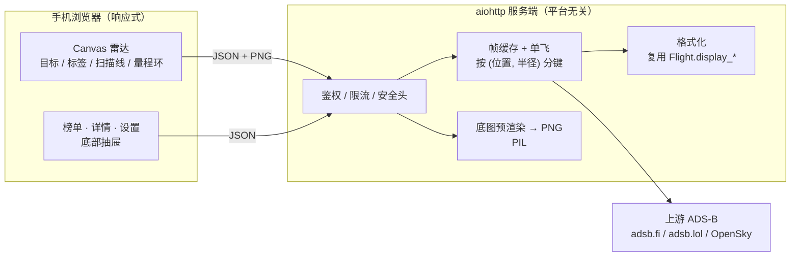

# Web 版设计（响应式 / 公网可访问）

把现有的 PySide6 桌面版改造成一个**手机浏览器可用的响应式 Web 应用**。
桌面版继续保留，两者共用同一套数据与几何逻辑。

已确认的三个前提：

| 决定 | 取值 | 后果 |
|---|---|---|
| 访问方式 | 公网可访问 | 必须做鉴权、限流、安全头；且服务端不能依赖 Windows |
| 渲染分工 | 服务端预渲染底图 + 客户端 Canvas | 底图是位图，目标/航迹/扫描线在客户端画 |
| 第一版范围 | 核心先跑通 | 雷达 + 榜单 + 详情 + 设置；其余后补 |

## 架构



## 复用边界

勘察结论：真正被 Qt 钉住的只有 4 个文件。**服务端不装 PySide6。**

| 直接复用（无 Qt） | 处理方式 |
|---|---|
| `data/models.py`、`base.py`、`registry.py`、`sources.py`、`enrich.py` | 原样用 |
| `data/source_tar1090.py`、`source_opensky.py`、`source_fr24.py` | 原样用 |
| `geo.py`（含 `Projector`）、`weather.py`、`airports.py`、`places.py`、`roads.py` | 原样用 |
| `config.py` | 原样用（服务端配置另存，见下） |
| `data/pipeline.py` | **本次新抽出的 Qt-free 编排层**，桌面版与 Web 版共用 |

| 原 Qt 耦合 | 处理方式 |
|---|---|
| `data/manager.py` | 已重构为只负责 QThread 调度，逻辑下沉到 `pipeline.py` |
| `terrain.py` | 只有 `elevation_color()` 返回 `QColor`；Web 端用 PIL 自己写色标（见下） |
| `basemap.py` | 只有 `paint()` 是 Qt；`Basemap.load()` / `paths(projector)` 可直接用 |
| `theme.py` | 调色板手抄进 CSS 变量 |
| `ui/*` 全部 | 重写（HTML/CSS/Canvas） |

**关键取舍：格式化放在服务端。** `Flight` 上已有大量 `display_*` 辅助方法
（航班号、海拔短标签、飞行阶段、ETA 文案、航向方位名…）。与其把十几条格式化规则
搬到 JS 里再维护一份，不如服务端算好放进 payload 的 `display` 子对象，客户端只负责摆位置。
这样 Web 版与桌面版的文案天然一致。

## 目录布局

```
webapp/
  __init__.py
  settings.py     # 服务端配置：监听地址、密码哈希、代理信任、会话时长
  auth.py         # scrypt 口令、会话令牌、登录节流
  limits.py       # 按 IP 的滑窗限流 + 上游冷却快照
  frames.py       # 帧缓存（按位置/半径分键）+ 单飞 + 后台刷新
  render.py       # 底图预渲染 → PNG（PIL，无 Qt）
  serialize.py    # Flight → JSON（含 display 子对象）
  server.py       # aiohttp 应用、路由、中间件、静态文件
  static/
    index.html
    app.css
    app.js        # 引导、状态、页面切换
    radar.js      # Canvas 渲染
    panels.js     # 榜单 / 详情 / 设置
```

## HTTP API 契约

所有 `/api/*` 都要通过会话校验，未登录返回 `401`。

| 方法 | 路径 | 说明 |
|---|---|---|
| `POST` | `/api/session` | `{password}` → 204 并下发 `Set-Cookie: frt_session=…`；失败 401 |
| `DELETE` | `/api/session` | 登出，清 cookie |
| `GET` | `/api/state` | 当前配置（**密钥字段已脱敏**）+ 定位 + 上游冷却余量 |
| `PUT` | `/api/config` | 局部更新配置，返回完整新配置 |
| `GET` | `/api/flights` | 参数 `lat`、`lon`、`radius_km`；返回一"帧" |
| `GET` | `/api/flight/{icao24}` | 单架详情（复用 `enrich`） |
| `GET` | `/api/basemap` | 参数 `lat`、`lon`、`radius_km`、`size`、`layers`；返回 `image/png` |
| `GET` | `/api/airports` | 参数 `q`、`limit`；机场检索（供跳转用） |
| `GET` | `/api/locate` | 服务端按 IP 粗定位；**客户端优先用浏览器 Geolocation** |

### 帧结构

```json
{
  "flights": [
    {
      "icao24": "780abc", "callsign": "CSN1234",
      "lat": 22.35, "lon": 114.18,
      "prev_lat": 22.34, "prev_lon": 114.17,
      "altitude_ft": 30000, "geo_altitude_ft": 30200,
      "ground_speed_kt": 430, "track": 42, "vertical_rate_fpm": 1200,
      "on_ground": false, "seen_pos": 3.2, "category": "A3",
      "origin_country": "China", "squawk": "1234",
      "distance_km": 5.2, "bearing": 33.4,
      "info": {"registration": "B-1234", "type_code": "B789",
               "type_name": "787 9", "manufacturer": "Boeing",
               "operator": "China Southern", "photo_url": ""},
      "route": {"origin_iata": "CAN", "destination_iata": "PEK",
                "airline": "China Southern"},
      "display": {
        "flight_number": "CSN1234", "altitude_short": "9.1km",
        "altitude": "9,144 m", "phase": "巡航", "heading": "042° NE",
        "vertical": "↑ 1,200 ft/min", "eta": "23:12",
        "route_label": "CAN → PEK", "distance": "5.2 km"
      }
    }
  ],
  "source": "adsblol", "notice": "", "stale": false,
  "center": [22.30314, 114.178832], "radius_km": 50.0,
  "fetched_at": "2026-09-25T23:40:00Z",
  "cooling": {"adsblol": 43}
}
```

`display` 之外都是原始量，客户端需要画几何（插值、航向）时用原始量，需要显示文案时用 `display`。

### 底图

`GET /api/basemap?lat&lon&radius_km&size&layers=terrain,roads,clouds,places,airports`

- 服务端按 `Projector(center, radius, size/2, size/2, size/2)` 渲染**正方形** PNG。
- `layers` 白名单过滤，非法值直接 400（防路径/枚举注入）。白名单常量为
  `webapp/settings.py` 的 `BASEMAP_LAYERS` —— 放在 HTTP 层而非渲染模块，
  这样渲染模块缺席时畸形请求仍得到 400 而不是被盖成 503。
  基础地理（陆地填充 + 海岸线）始终绘制，不受 `layers` 控制；不带 `layers` 是合法请求。
- 高程色标按桌面版 LUT 在 PIL 侧重写，不引入 Qt：
  0 m `(34,92,62)`、200 `(60,118,68)`、600 `(104,146,74)`、1200 `(168,172,84)`、
  2000 `(207,160,76)`、3000 `(203,112,62)`、4500 `(186,72,60)`、6500 `(150,44,58)`；
  海平面以下透明；整体不透明度 0.34。
- 客户端把这张方形图按圆形裁剪后铺在雷达盘下。

## 公网安全模型

这是"能公网访问"这个决定带来的**必须做**的部分，不是可选项。

| 面 | 措施 |
|---|---|
| 口令 | `hashlib.scrypt` + 每实例随机盐；哈希只存服务端；首次启动若未设置则生成随机口令打到控制台 |
| 会话 | 32 字节 `secrets.token_urlsafe`，服务端内存表 + 过期时间；Cookie 走 `HttpOnly` + `SameSite=Strict` + `Secure`（HTTPS 时）+ `Path=/` |
| CSRF | `SameSite=Strict` 之上，所有写操作再要求自定义头 `X-Requested-With`；缺失即 403 |
| 登录节流 | 按 IP：5 次失败 → 指数退避锁定；成功即清零 |
| 接口限流 | 按 IP 滑窗（如 240 次/分钟），指数 429 |
| 上游保护 | 帧缓存 TTL = `refresh_sec`；同键**单飞**，并发请求共享同一次上游拉取；`UpstreamGuard` 全局冷却 |
| 代理头信任 | **仅在 `FRT_TRUST_PROXY=1` 时**才采信 `X-Forwarded-For`，否则客户端可伪造 IP 绕过限流 |
| 密钥脱敏 | `GET /api/state` / `PUT /api/config` 一律不返回 `fr24_api_key` 明文，只返回 `has_key: true/false` |
| 输入校验 | 纬度 ±90、经度 ±180、半径 2–460、`size` 64–2048、`layers` 白名单；越界一律 400 |
| 静态文件 | 只服务 `webapp/static/**`，解析后做路径包含检查，禁目录列举 |
| 响应头 | `Content-Security-Policy: default-src 'self'; img-src 'self' data:; connect-src 'self'`、`X-Content-Type-Options: nosniff`、`X-Frame-Options: DENY`、`Referrer-Policy: no-referrer`；HTTPS 下加 HSTS |
| 请求体 | `client_max_size` 限制（如 16 KB） |

### 定位：为什么不用 winsdk

公网部署通常落在 Linux 服务器上，`winsdk` 是 Windows 专用。而手机浏览器自带的
Geolocation API 精度远高于任何 IP 粗定位，还附带用户授权。
所以**定位以客户端为主**，`/api/locate` 只作为用户拒绝授权时的兜底。

## 响应式与触屏改造

桌面版有 12 处交互在手机上不可用（勘察已逐条列出），其中影响最大的是：
**雷达只能靠鼠标滚轮缩放**，以及侧栏 25% 固定宽度在竖屏下不可用。

第一版处理：

- 布局：窄屏（< 860px）雷达全屏铺满，榜单/详情/设置改成底部抽屉（可上滑展开）；
  宽屏维持近桌面版的左右 3:1 分栏。
- 缩放：双指捏合 + 常驻 `−` / 半径滑块 / `+`，并在雷达上显示当前量程文字。
  沿用桌面版的 16 档量程：2/5/10/15/20/25/30/50/75/100/150/200/250/300/400/460 km。
- 选择：去掉 hover 语义。单击选中，再点一次进详情；命中半径由 22px 提到 44px。
- 目标动画：客户端按 `prev_lat/prev_lon` → `lat/lon` 做插值，扫描线仍在客户端画。
- 无拖拽平移（沿用桌面版行为：圆心只通过跳转机场 / 回本机改变）。

## 部署

服务端不依赖 Windows、不依赖 PySide6。可行路径：

1. **云主机 + 反代**：Linux VPS 上 `python -m webapp.server`，前置 nginx/Caddy 做 TLS；
   `FRT_TRUST_PROXY=1`，`Secure` cookie 生效。
2. **内网穿透**：本机或小主机跑服务，用 Cloudflare Tunnel / frp 暴露，同样让反代终止 TLS。
3. **不要**直接把 `aiohttp` 明文监听到公网 —— 口令与会话会以明文过网。

首次启动会下载约 81 MB 底图/机场/地名数据到服务端本地，之后走本地缓存。
上游 ADS-B 有配额，所以帧缓存与全局冷却是**公网可用性**的前提，不是优化项。

## 分阶段

1. **本次**：勘察、抽取 Qt-free 编排层（含测试）、契约定稿。
2. 服务端：`settings/auth/limits/frames/serialize/server`，先让 `/api/flights` 通。
3. 底图预渲染 `render.py`。
4. 前端骨架 + 响应式布局（窄屏全屏雷达 + 底部抽屉）。
5. 雷达 Canvas 渲染（底图位图 + 量程环 + 扫描线 + 目标/标签/插值）。
6. 榜单 / 详情 / 设置三个页面（含触屏改造）。
7. 安全联调：鉴权、CSRF、限流、代理头信任、脱敏逐项验证。
8. 手机实测 + 部署文档。
